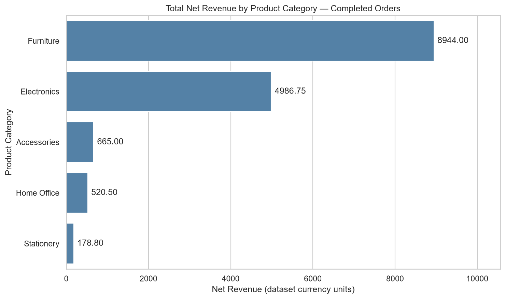
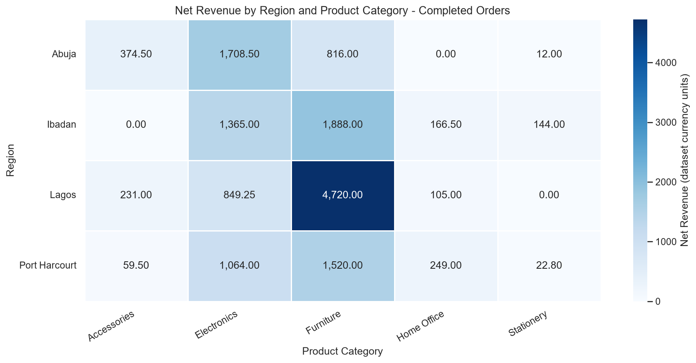
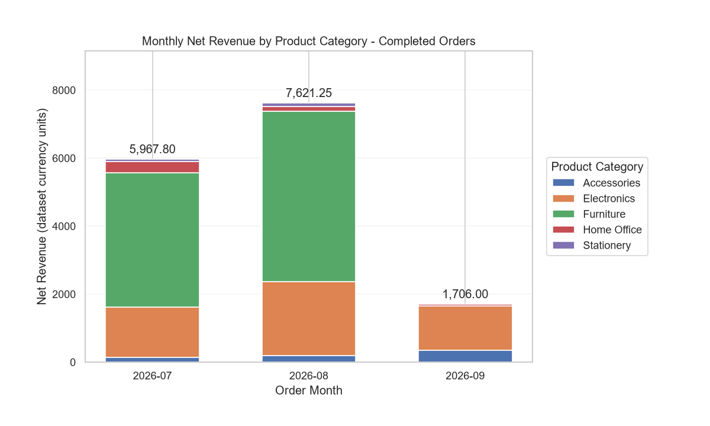
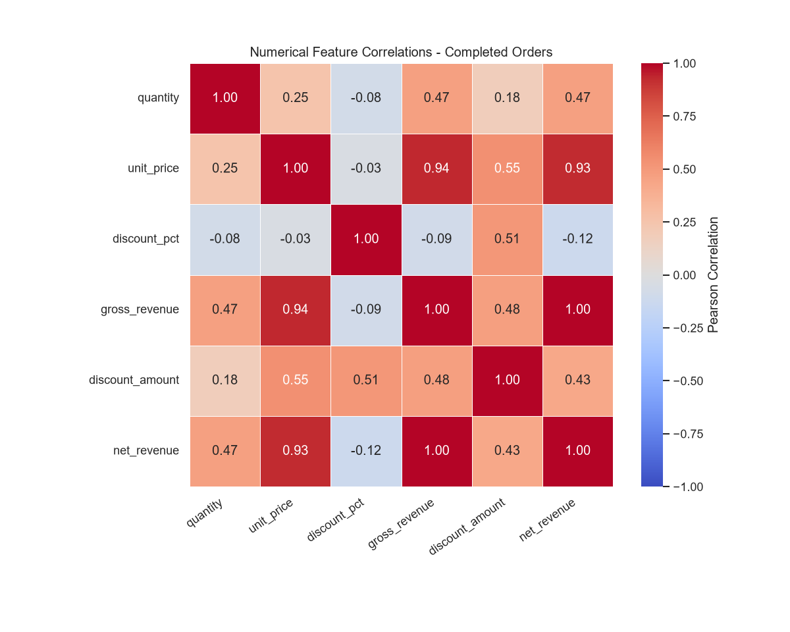

# Retail Sales — Exploratory Data Analysis

An exploratory data analysis project investigating retail transaction patterns, product performance, regional revenue, monthly sales trends, and numerical relationships using Python.

## Project Overview

This project analyzes 80 retail order records spanning July–September 2026.

The objective is to identify meaningful sales patterns and translate analytical findings into actionable business recommendations.

The analysis builds upon a previous Pandas data-cleaning and feature-engineering workflow.

### Business Questions

1. Which product categories contribute the most revenue?
2. How does completed-order revenue vary across regions?
3. Are sales concentrated in a small number of high-value transactions?
4. How does revenue change across the observed months?
5. What relationships exist between quantity, unit price, discounts, and net revenue?

## Dataset and Business Rules

The dataset contains 80 orders and 15 columns, including transaction identifiers, dates, products, geographical regions, payment methods, quantities, prices, discounts, order statuses, and engineered revenue metrics.

| Order Status | Number of Orders |
|---|---:|
| Completed | 51 |
| Cancelled | 17 |
| Pending | 12 |
| **Total** | **80** |

Only **Completed** orders are included in realized-revenue analyses.

The full cleaned dataset is retained for data-quality checks and operational analyses.

### Key Metrics

| Metric | Value |
|---|---:|
| Total order records | 80 |
| Completed orders | 51 |
| Completed net revenue | 15,295.05 |
| Highest-revenue category | Furniture |
| Highest-revenue region | Lagos |
| Highest-revenue month | August 2026 |

Monetary figures are reported in dataset currency units.

## Tools and Technologies

- Python
- Pandas
- NumPy
- Matplotlib
- Seaborn
- Jupyter Notebook
- VS Code
- Git

python -m pip install -r eda/retail_sales_eda/requirements.txt

## Analytical Workflow

The project follows these steps:

1. Load the cleaned retail dataset.
2. Inspect data quality, missing values, and order statuses.
3. Filter completed transactions for revenue analysis.
4. Explore numerical and categorical distributions.
5. Identify potential outliers using the IQR method.
6. Analyze revenue across products and regions.
7. Investigate monthly revenue and product mix.
8. Examine numerical relationships using Pearson correlation.
9. Develop business findings and recommendations.

## Key Findings

### 1. Revenue Concentration in Furniture

Furniture generated 8,944.00 in completed-order net revenue, representing **58.48% of total completed revenue**, despite accounting for only seven completed orders.

All seven completed Furniture transactions involved Standing Desks.

These high-value transactions were identified as potential statistical outliers using the IQR method. They were retained because the values were consistent with high unit prices and multi-unit purchases.

**Business implication:** Revenue is concentrated in a small number of high-value transactions, creating potential exposure to changes in Standing Desk availability or demand.

**Recommendation:** Investigate product profitability, inventory availability, and longer-term demand while maintaining other revenue-generating categories.

### 2. Lagos Leads Regional Revenue

Lagos generated 5,905.25 in completed-order revenue, representing **38.61% of total completed revenue**.

Although Abuja recorded the most completed orders (15), Lagos generated higher revenue from 14 completed orders.

Furniture contributed 4,720.00, approximately 79.93% of Lagos's revenue.

**Business implication:** Product mix is a significant factor associated with regional revenue differences.

**Recommendation:** Evaluate Standing Desk demand, inventory levels, and profitability across regions before making regional investment decisions.

### 3. Revenue Increased in August

Monthly completed-order revenue was:

| Month | Completed Orders | Net Revenue |
|---|---:|---:|
| July 2026 | 20 | 5,967.80 |
| August 2026 | 20 | 7,621.25 |
| September 2026 | 11 | 1,706.00 |

August revenue increased by approximately 27.7% compared with July, despite both months recording the same number of completed orders.

Furniture and Electronics were the largest positive contributors to the increase.

**Business implication:** Revenue growth was associated with higher average transaction values and changes in product-level sales activity, rather than growth in total completed-order count.

### 4. Numerical Relationships

Pearson correlation analysis identified a moderate positive relationship between quantity and net revenue across all completed orders (r = 0.468).

Excluding Standing Desk transactions increased this correlation to 0.678, demonstrating sensitivity to product composition.

Gross revenue and net revenue had a near-perfect positive correlation (r = 0.999), consistent with their mathematical relationship.

These correlations should not be interpreted as evidence of causation.

## Selected Visualizations

### Revenue by Product Category

### Regional Revenue by Product Category

### Monthly Revenue Composition

### Numerical Correlations

Additional visualizations, including scatter plots and monthly revenue trends, are available in the `outputs/figures/` directory.

## Reproducing the Analysis

1. Clone the `ml-engineering-foundations` repository.
2. Create and activate a Python virtual environment.
3. Install the required packages: `pandas`, `numpy`, `matplotlib`, `seaborn`, `pillow`, `ipykernel`, and `jupyter`.
4. Open the repository folder in VS Code.
5. Open `notebooks/01_retail_sales_eda.ipynb`.
6. Select the project's Python virtual environment as the notebook kernel.
7. Restart the kernel and run all cells.

The notebook reads the cleaned dataset generated by the Day 3 project:

`pandas/retail_orders_analysis/outputs/cleaned_retail_orders.csv`

The notebook's path configuration locates the dataset relative to the repository root.

Figures are saved to `eda/retail_sales_eda/outputs/figures/`.

## Limitations

- The dataset contains only 80 orders and 51 completed transactions.
- The observed period spans approximately three months and is insufficient for establishing seasonality.
- The completeness of the September reporting period has not been independently verified.
- Revenue does not equal profit; product costs and margins are unavailable.
- Inventory and stockout information is unavailable.
- Correlations do not establish causal relationships.
- Some financial variables are mathematically dependent.
- Findings should be validated with larger datasets before major business decisions.

## Future Improvements

- Investigate payment methods across all order statuses.
- Analyze repeat purchases and customer retention.
- Incorporate inventory and profitability data.
- Explore longer-term monthly and seasonal performance.
- Introduce automated data-quality tests.
- Extend the project toward predictive sales analysis.

---

**Project focus:** Reproducible exploratory analysis, business reasoning, statistical interpretation, and professional data visualization.
